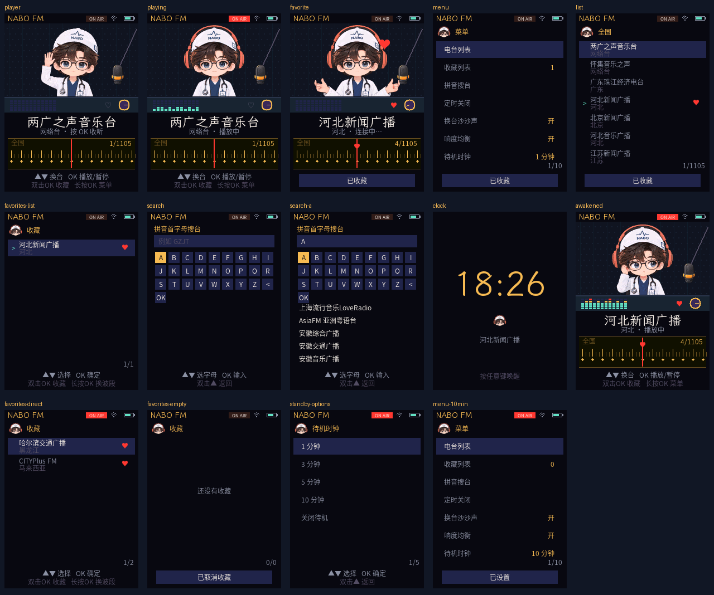

# AI Passport · NABO FM × 小智

ESP32-C3 / 8 MB FoloToy AI Passport 的电台专用固件，从牌桌 v1.6.0 分出。保留 NABO 小智动画和设备设置，电台采用午夜琥珀配色、霞鹜文楷台名、思源黑体小字，以及原 NABO 的 13 个 DJ 动作。

**首个公开版本 v1.0.0 · 体验版（2026-10-19）** 使用已在工牌运行的候选 03 精确应用；包含独立收藏列表、北京时间、1/3/5/10 分钟或关闭待机，以及提高响度的播放处理。[下载固件](https://github.com/Liutupi/ai-passport-nabo-xiaozhi-radio/releases/tag/v1.0.0) · [首版说明](docs/RELEASE_FM_v1.0.0.md)。

这是部分实机验证的首版：**不保证全部 1,105 台可播或长时无卡顿；AAC/HE-AAC 和部分失效/超时台源仍待解决。** 04/05 实验没有发布，当前主分支的固件源码与 03 快照一致。下图为生产绘制代码生成的宿主预览，不是工牌照片。



已接入：

- 1,105 台内置台表；全国、收藏、最近、类型、各地区波段；拼音首字母搜索；可手动选择本地地区。
- 停手 500 ms 后连接；下键长按加速扫台；上键单击先移动，双击撤回并返回。
- OK 单击播放/暂停，双击收藏，长按菜单。列表每屏七台；收藏和最近使用稳定 ID 保存。
- 13 个动作、247 帧的 NABO DJ 动画；8 行条带直绘，按条带校验值跳过未变画面。
- 1 KiB 小块组成的 8/16/32 KiB 自适应压缩环；Helix MP3、Espressif ADTS AAC 接入；半带 FIR、慢速响度均衡、高通、淡入/暂停收尾和限幅；输出跟随台的采样率。
- 独立收藏列表、定时关闭、最后一分钟渐弱、闲置 1/3/5/10 分钟或关闭待机时钟、任意键只唤醒、换台沙沙声开关。
- `self.radio.search/play/next/random/pause/resume/set_volume/now_playing/favorite/sleep_timer` 设备工具；当前电台与小智切换音频所有权，播放中同时语音和 20% 压低尚未实现。

待完成：国内网络下的逐台复测、AAC 兼容性、自动 IP 地区定位、在线台表更新、边播边语音，以及真实硬件上的音质/内存/长时间连播验证。HLS、ICY 曲名、通用点歌、离线助眠声和 DLNA 仍按原设计后续分期处理。

[使用指南](docs/USER_GUIDE.md) · [构建](docs/BUILD.md) · [交接](docs/HANDOFF.md) · [验证](docs/VALIDATION.md) · [刷写](docs/FLASHING.md) · [许可](THIRD_PARTY_NOTICES.md)

```powershell
# 已初始化 ESP-IDF 6.0.2 的终端
python tools/build.py
# GCC/G++ 在 PATH；Windows 的 CXX 使用 g++，避免反斜杠被 shlex 解释
python tools/run_tests.py
```

动画、子集字体和台表在板型的 `radio_assets/`；原设计、美术和源字体在 `design/nabo-radio/`。克隆后执行 `python tools/verify_handoff.py` 核对资源，正常编译不依赖原电脑的素材目录。NABO 形象和美术不随源码的 MIT 许可授权。

分区及 `ai-passport-nabo` 板型身份保持兼容；首次接入电台需写应用和资源，资源相同时后续修复可仅写应用。当前所选设备的 bootloader 与构建包字节不同，通用升级工具会保护性拒绝，具体边界见交接本。每次都须识别 live MAC、备份及写后核对。
