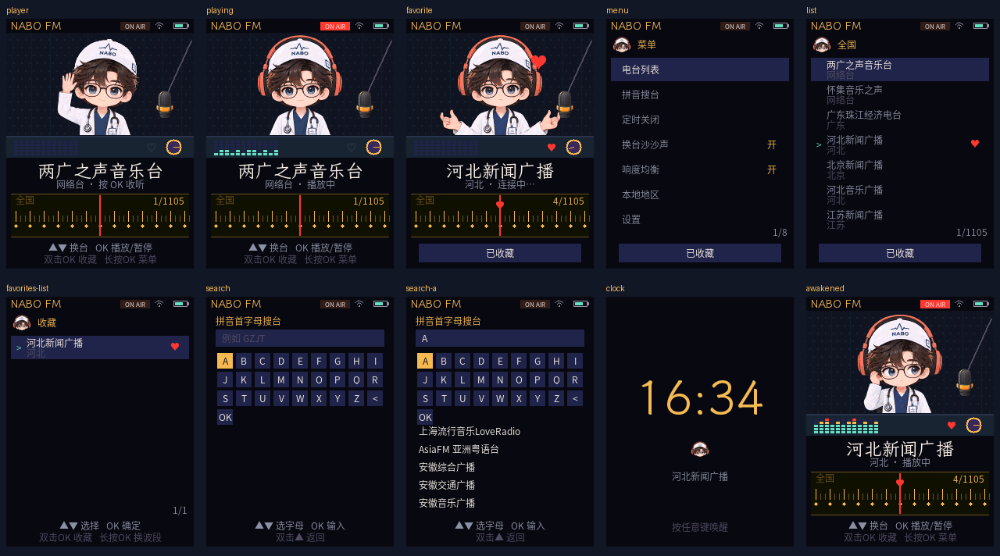

# AI Passport · NABO FM × 小智

让工牌，也有自己的电台时光。NABO 戴上耳机，当你的随身 DJ：听音乐、跟新闻，把喜欢的台留在收藏里，闲置时再变成一只北京时间小钟。


适用 ESP32-C3 / 8 MB FoloToy AI Passport；午夜琥珀界面、文楷台名与 13 个 NABO DJ 动作。展示图由现有原画与生产代码宿主界面预览组成，非实机照片。[社区介绍](docs/COMMUNITY_v1.0.1.md)。

**v1.0.1 · 部分验收体验更新（2026-10-31）。** 使用已刷入的封存 06r5 精确镜像，调整解码内存布局、语音与电台资源交接、断粮恢复及网络等待。实际发布 / 审核状态以 [GitHub Releases](https://github.com/Liutupi/ai-passport-nabo-xiaozhi-radio/releases) 和社区页面为准。[本次说明](docs/RELEASE_FM_v1.0.1.md) · [安装与升级](docs/FLASHING.md) · [历史 v1.0.0](https://github.com/Liutupi/ai-passport-nabo-xiaozhi-radio/releases/tag/v1.0.0)。

**这是部分验收的体验版。** Build 与 16 脚本 Host 套件通过；台 26 约 3 分钟短测、2 轮主页往返通过，用户确认当前声音“连续、清楚”。剩余完整验收由用户主动提前结束，三台各 600 秒和 20 次受控切台尚未完成；不代表全部 QA 或长播无卡顿。AAC/HE-AAC、部分失效台源及空白设备完整首装仍未验收，1,105 是目录数量，不保证全部台可播。详见 [设备记录](validation/radio-candidate06r5-device-2026-10-31.json)。



已接入：

- 1,105 台内置目录；全国、收藏、最近、类型和地区波段；拼音首字母搜索，手动本地地区。
- 上下换台，停手 500 ms 后连接；按住下键加速扫台。OK 单击播放/暂停、双击收藏、长按菜单。
- 独立收藏列表、最近十台、定时关闭与最后一分钟渐弱；1/3/5/10 分钟或关闭待机时钟，任意键第一次只唤醒。
- 13 个动作、247 帧 NABO DJ 动画；北京时间小钟与换台沙沙声开关。
- 8/16/32 KiB 自适应压缩环、Helix MP3、ADTS AAC 接入、响度均衡与淡入淡出。AAC 接入不代表兼容性已经验收。
- 电台与小智切换音频所有权；播放时暂停语音，长按上键停止电台并回小智后再对话。

本次释放停用的语音 codec 工作区，让既有自适应环在当前设备实际选到 32 KiB；不保证每次或每台设备都获得相同内存。没有新增边播边语音、自动地区定位或在线台表更新。

[使用指南](docs/USER_GUIDE.md) · [构建](docs/BUILD.md) · [交接](docs/HANDOFF.md) · [验证](docs/VALIDATION.md) · [刷写](docs/FLASHING.md) · [许可](THIRD_PARTY_NOTICES.md)

```powershell
# 已初始化 ESP-IDF 6.0.2 的终端
python tools/build.py
# GCC/G++ 在 PATH；Windows 的 CXX 使用 g++，避免反斜杠被 shlex 解释
python tools/run_tests.py
```

发布包沿用封存 06r5 镜像，不为改版本号重新编译。应用 SHA256 为 `282cf47d20af170dccbcaf0e6b06c84cbf73cea8e8752744f9a0f0463d90f836`；最终源码提交、镜像与校验值由随包 manifest 绑定。内部上游版本字符串不作为发行身份。

动画、子集字体和台表在板型的 `radio_assets/`；原设计、美术和源字体在 `design/nabo-radio/`。克隆后执行 `python tools/verify_handoff.py` 核对资源，正常编译不依赖原电脑素材目录。NABO 形象与美术不随源码 MIT 许可授权。

分区及 `ai-passport-nabo` 板型身份保持。完整 BIN 从 `0x0` 安装会清空配网、激活和 NVS 设置；保留数据请先读刷写说明并执行设备、备份及保护区校验。历史设备可能采用不同 bootloader，不能直接推定可仅刷本次应用。
